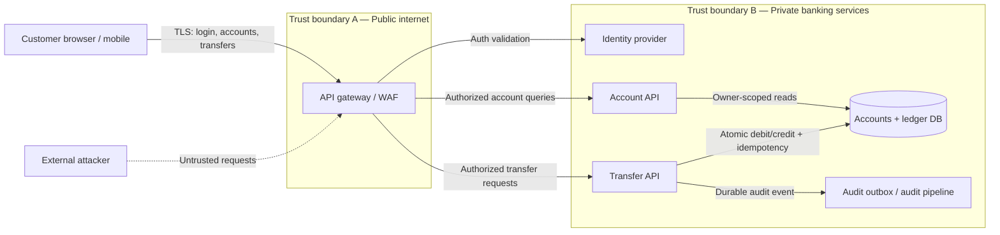

# Banking REST API — Threat Modeling Case Study

**Frameworks:** STRIDE · MITRE CAPEC · OWASP API Security Top 10 (2023)  
**System:** Online banking application supporting account viewing and money transfers through REST APIs  
**Status:** Proposed architecture / design-time assessment — **not** a penetration-test report  
**Review date:** 2026-10-29

> **Purpose:** Identify likely attack paths, prioritize potential impacts, and define concrete mitigations and verification tests before deployment. This is a fictional reference architecture; adapt the assumptions and findings to your actual application.

## 1. Problem statement

Customers can sign in, view their bank accounts and balances, and transfer funds using REST APIs. Because the system handles personal financial information and moves money, the primary security goals are **protect account ownership**, **prevent unauthorized/duplicate transfers**, **preserve ledger integrity**, **maintain traceability**, and **keep APIs available**.

### Scope and assumptions

- Clients: web or mobile customer application; untrusted clients communicate over HTTPS.
- APIs: `POST /auth/login`, `GET /accounts`, `GET /accounts/{accountId}`, `POST /transfers`, and `GET /transfers/{transferId}` (illustrative, not discovered endpoints).
- Backend: API gateway, identity provider, account service, transfer service, ledger datastore, and audit service.
- Customers are authenticated via securely validated tokens or sessions. **Cookie-based sessions are an optional variant**; the CSRF scenario only applies when credentials are automatically sent by browsers.
- Transfer service owns authorization, limits, balance checks, and durable ledger postings. The client **never** determines its own permissions or final balance.
- External payment rails, employees' admin systems, KYC, fraud analytics, cloud infrastructure, and mobile malware are out of the core scope; document separately if present.

## 2. High-level data flow diagram



**Trust boundaries:** (A) client-to-API ingress; (B) gateway-to-internal services; (C) service-to-ledger and service-to-audit persistence. Each crossing requires explicit identity, authorization, integrity, and data-handling controls. See [architecture and trust boundaries](docs/01-system-and-trust-boundaries.md) and editable [Mermaid DFD](diagrams/banking-dfd.mmd).

## 3. Threat identification using STRIDE

| STRIDE category | Example threat in this banking app | Threat IDs |
|---|---|---|
| **S**poofing | Credential attacks or stolen session impersonates a customer | T-01, T-02 |
| **T**ampering | Transfer amount/recipient edited, concurrent spending, or SQL inputs | T-05, T-06, T-08 |
| **R**epudiation | User or operator denies a transfer when audit trail is incomplete or mutable | T-12 |
| **I**nformation disclosure | Accessing someone else's account or excessive API details | T-03, T-11, T-13 |
| **D**enial of service | Request flooding makes login or transfers unavailable | T-10 |
| **E**levation of privilege | Ordinary customer reaches internal/admin endpoints | T-04 |

Additional business-flow risk: **duplicate transfer submission/replay** (T-07), and **CSRF when cookie authentication is used** (T-09).

## 4. Prioritized risk register

This is an **illustrative inherent-risk assessment**, not evidence of exploitability. Score = likelihood (1–5) × impact (1–5): **Critical 15–25**, **High 10–14**, **Medium 5–9**, **Low 1–4**. Scores and conditional assumptions must be revalidated for a real application.

| ID | Potential security risk | L × I | Priority | MITRE CAPEC |
|---|---|---:|---|---|
| T-01 | Brute-force password / authentication attack | 4 × 5 = 20 | Critical | [CAPEC-112](https://capec.mitre.org/data/definitions/112.html) |
| T-02 | Theft and misuse of an authenticated session | 4 × 5 = 20 | Critical | [CAPEC-593](https://capec.mitre.org/data/definitions/593.html) |
| T-03 | Broken object-level authorization (IDOR/BOLA) | 4 × 5 = 20 | Critical | [CAPEC-1](https://capec.mitre.org/data/definitions/1.html) |
| T-04 | Customer access to privileged functions | 2 × 5 = 10 | High | [CAPEC-122](https://capec.mitre.org/data/definitions/122.html) |
| T-05 | Client-controlled transfer data alters business logic | 4 × 5 = 20 | Critical | [CAPEC-77](https://capec.mitre.org/data/definitions/77.html) |
| T-06 | Concurrent transfer race / double spend | 3 × 5 = 15 | Critical | [CAPEC-26](https://capec.mitre.org/data/definitions/26.html) |
| T-07 | Duplicate requests cause unintended repeated transfer | 3 × 5 = 15 | Critical | No precise direct CAPEC match* |
| T-08 | SQL injection into account/transfer queries | 3 × 5 = 15 | Critical | [CAPEC-66](https://capec.mitre.org/data/definitions/66.html) |
| T-09 | CSRF triggering transfer via browser cookie | 2 × 5 = 10 | High **if applicable** | [CAPEC-62](https://capec.mitre.org/data/definitions/62.html) |
| T-10 | Resource exhaustion / API request flooding | 3 × 4 = 12 | High | [CAPEC-125](https://capec.mitre.org/data/definitions/125.html) |
| T-11 | Account details or error messages reveal sensitive information | 3 × 3 = 9 | Medium | [CAPEC-116](https://capec.mitre.org/data/definitions/116.html) |
| T-12 | Missing, incomplete, or modifiable audit evidence | 3 × 4 = 12 | High | No precise direct CAPEC match* |
| T-13 | Network interception or alteration of API traffic | 2 × 5 = 10 | High | [CAPEC-94](https://capec.mitre.org/data/definitions/94.html) |

*CAPEC catalogs **attack patterns**, not every system design flaw. We deliberately do **not** label duplicate business requests as [CAPEC-60](https://capec.mitre.org/data/definitions/60.html), which specifically refers to **session ID replay**. Likewise, insufficient audit logging is a weakness enabling repudiation, not itself a CAPEC attacker technique.

### Top design controls to implement first

1. **Enforce object ownership on every account and transfer API request:** resolve the acting user from the validated identity and check access against the requested object on the server (T-03/T-04).
2. **Protect money movement end-to-end:** re-derive the source account owner, validate the destination/amount/limits, require appropriate step-up authentication for high-risk transfers, and verify the transaction shown to the customer matches the one executed (T-05/T-09).
3. **Commit transfers atomically and exactly once per idempotency key:** lock or serialize affected balances, store a unique operation record, and reject reuse of a key with different payment parameters (T-06/T-07).
4. **Harden authentication and session management:** rate-limit login attempts; apply phishing-resistant MFA where possible; validate token signature, issuer, audience and expiry; prevent token leakage (T-01/T-02).
5. **Use parameterized database statements, least-privilege service credentials, and immutable audit evidence** (T-08/T-12).

## 5. Example abuse cases

**A. Account data exposure (T-03).** Alice signs in and requests `GET /accounts/ACC-100`. If changing the path to Bob's `ACC-200` succeeds, the API has an object authorization failure. **Expected:** `403`/`404` and no sensitive data; audit the denied access.

**B. Unauthorized transfer / tampering (T-05).** The app sends a transfer request. An attacker with a customer session edits `sourceAccountId`, `destinationAccountId`, or `amount` before submission. **Expected:** the API validates ownership, business rules, amount, limits, and confirmed destination on the server; unauthorized changes fail without posting funds.

**C. Double debit (T-06/T-07).** Two nearly simultaneous submissions use the same funding account or a retry occurs after a timeout. **Expected:** concurrent requests cannot overspend; identical retries return the same operation result and do not post additional ledger entries.

See [three detailed attacker scenarios](docs/06-attack-scenarios.md).

## 6. Repository map

```text
banking-rest-api-threat-model/
├── README.md
├── docs/
│   ├── 01-system-and-trust-boundaries.md
│   ├── 02-stride-analysis.md
│   ├── 03-mitre-capec-mapping.md
│   ├── 04-risk-register.md
│   ├── 05-mitigations-and-security-tests.md
│   └── 06-attack-scenarios.md
├── diagrams/
│   ├── banking-dfd.mmd
│   └── transfer-sequence.mmd
└── .github/ISSUE_TEMPLATE/
    └── security-risk.md
```

| File | What you'll find |
|---|---|
| [System and boundaries](docs/01-system-and-trust-boundaries.md) | Assets, actors, data flows, assumptions, security objectives |
| [STRIDE analysis](docs/02-stride-analysis.md) | STRIDE table mapped to all threat IDs |
| [MITRE CAPEC mapping](docs/03-mitre-capec-mapping.md) | Verified CAPEC titles, relevance, conditions, and OWASP API categories |
| [Risk register](docs/04-risk-register.md) | Risk scoring, recommended owner, response, and treatment status |
| [Mitigations and test cases](docs/05-mitigations-and-security-tests.md) | Testable acceptance criteria per threat |
| [Attack scenarios](docs/06-attack-scenarios.md) | Safe high-level attack paths and defensive breakpoints |
| [Transfer sequence](diagrams/transfer-sequence.mmd) | Idempotent, atomic money-movement design |

## 7. How to publish this project on GitHub

1. Create a repository named **`banking-rest-api-threat-model`** with the description: *STRIDE and MITRE CAPEC threat modeling of account viewing and money transfers through banking REST APIs.*
2. Upload the files and folders, keeping the **`README.md` at the repository root**. GitHub renders Mermaid diagrams inside Markdown automatically.
3. Use the suggested topics: `threat-modeling`, `mitre-capec`, `stride`, `api-security`, `banking-security`, `owasp-api-top-10`, `devsecops`.
4. Edit the author section, actual auth model, deployment architecture, risk scores, and test status to match your project. Never commit production account numbers, live endpoint secrets, customer information, or exploit payloads against real systems.
5. Track unresolved risks using the included **Security risk** GitHub Issue template. Only call a finding *confirmed* after evidence-based, authorized validation.

If you prefer Git on your computer after creating an **empty** GitHub repository:

```bash
git init
git add .
git commit -m "Add banking REST API STRIDE and CAPEC threat model"
git branch -M main
git remote add origin https://github.com/YOUR_USERNAME/banking-rest-api-threat-model.git
git push -u origin main
```

## 8. References

- [MITRE CAPEC — Common Attack Pattern Enumeration and Classification](https://capec.mitre.org/)
- [OWASP API Security Top 10 (2023)](https://api-security.owasp.org/editions/2023/en/0x11-t10/)
- [Microsoft STRIDE threat modeling](https://learn.microsoft.com/en-us/azure/security/develop/threat-modeling-tool-threats)
- [Reference repository that inspired the structure](https://github.com/rkihonge/Threat-Modelling/blob/main/README.md) (original writing and analysis in this project)

---
**Disclaimer:** This repository is for architecture review and learning. Risks are hypotheses until tested in an authorized environment. MITRE CAPEC mappings are analyst-selected analogues, not an assertion that MITRE has directly mapped each API vulnerability to a CAPEC pattern.
